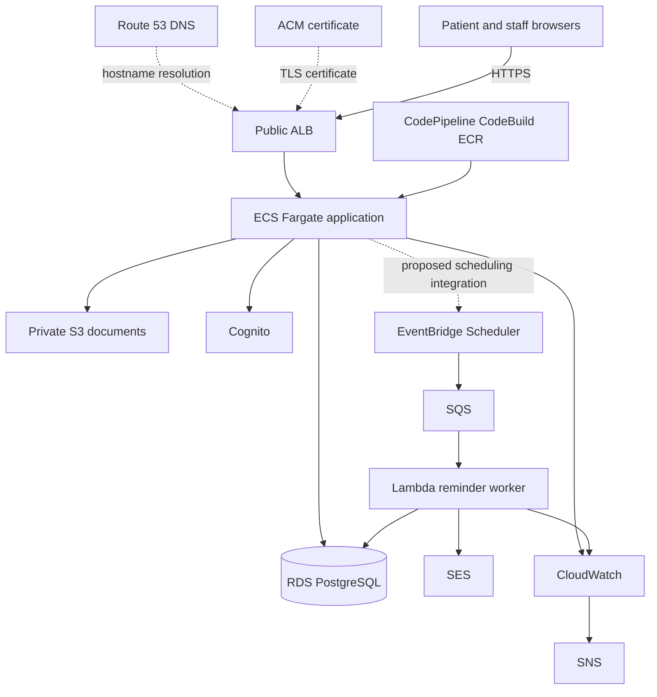

# ClinicFlow Architecture Decisions

| Field | Value |
| --- | --- |
| Document | `docs/architecture-decisions.md` |
| Project | ClinicFlow |
| Milestone | 0 — requirements consolidation |
| Status | Draft for review. No infrastructure is authorized. |
| Version | 1.0 — consolidated review baseline |
| Date | 2026-10-26 |
| Region | `us-east-1` |
| Companion | `docs/clinicflow-final-requirements.md`, `docs/acceptance-criteria.md` |

## 1. Decision summary

The target service choices below are approved. ADR-012 remains open: affordability against the $25 monthly account budget has not been established. A current account-wide cost review and approved deployment profile are required before any apply.

Approval applies to the services and outcomes supplied by the owner. Detailed schema, runtime topology, security mechanisms, and procedures below are proposed implementation details unless explicitly supplied in the approved brief. They are not additional discovery findings.

| ID | Topic | Decision | Status |
| --- | --- | --- | --- |
| ADR-001 | System of record | Amazon RDS for PostgreSQL | Approved |
| ADR-002 | Application compute | Amazon ECS on Fargate | Approved |
| ADR-003 | Patient documents | Private Amazon S3 with Versioning | Approved |
| ADR-004 | Identity | Amazon Cognito for authentication, application backend for authorization | Approved |
| ADR-005 | Reminders | EventBridge Scheduler, SQS, Lambda, SES | Approved |
| ADR-006 | Network | VPC across two Availability Zones, public ALB, private application subnets, private database subnets | Approved target |
| ADR-007 | Monitoring | Amazon CloudWatch and Amazon SNS | Approved |
| ADR-008 | Delivery | CodePipeline, CodeBuild, ECR, controlled ECS deployments with rollback | Approved |
| ADR-009 | Recovery | RDS point-in-time recovery, S3 Versioning, tested recovery procedures | Approved |
| ADR-010 | Cost management | AWS Budgets, estimates, tagging, anomaly monitoring, unused-resource cleanup | Approved |
| ADR-011 | Application stack | React, TypeScript, Node.js, Docker, Terraform | Approved supporting technologies |
| ADR-012 | Deployment profile versus $25 cap | Unresolved. Apply is blocked. | TBD-21 |
| ADR-013 | Kubernetes | Not used | Approved exclusion |

Supporting services that are part of the approved security and edge design: IAM, Secrets Manager, Route 53, ACM, HTTPS, and CloudTrail.

## 2. Context

ClinicFlow stores a single clinic schedule, enforces therapist and room conflicts, stores patient documents privately, and sends email reminders. The expected scale is about six employees and about 80 appointments per day. That scale does not require a second database, a cache tier, or a container orchestrator beyond ECS.

The account constraint is $25 per month for all AWS spend. Project 1 may be turned off only after a cost review and an explicit approval, and its GitHub repository, Terraform source, and recovery information must be kept.

Milestone 0 records decisions. It does not apply them.

## 3. Target architecture



Approved path:

1. Users reach the application over HTTPS. Route 53 names the site. ACM supplies the certificate. The public Application Load Balancer forwards to the application.
2. The application runs as containers on ECS Fargate in private subnets in the target design.
3. PostgreSQL in private database subnets is the only schedule.
4. Document bytes go to a private S3 bucket. The application decides who may upload or download.
5. Cognito authenticates users. The Node.js backend authorizes each action.
6. EventBridge Scheduler starts reminder work. SQS buffers it. Lambda sends email through SES after reading preference, consent, and appointment facts.
7. CloudWatch collects health and failure signals. SNS notifies operators.
8. CodePipeline and CodeBuild build images, store them in ECR, and deploy to ECS with a rollback path.
9. RDS point-in-time recovery and S3 Versioning are the approved data-recovery mechanisms. Both have written, tested procedures before go-live.
10. Budgets, tags, anomaly detection, and unused-resource cleanup guard the account.

Kubernetes is not part of the design.

## 4. ADR-001 — RDS PostgreSQL

**Status:** Approved

**Decision:** Store patients, staff, rooms, hours, exceptions, appointments, waitlist entries, consent, reminder preferences, document metadata, and the application audit history in Amazon RDS for PostgreSQL.

**Reason:** Booking is relational. A correct schedule needs transactions across therapist, room, and time range. PostgreSQL can enforce the conflict rules in one commit. A document store or a per-channel calendar would split the schedule that the business required to stay unified.

**Consequences:**

- The application writes every channel through this database.
- Credentials live in AWS Secrets Manager, not in source code or images.
- Point-in-time recovery is enabled.
- The database is not placed on a public subnet and does not receive a public address.
- Automated backups and PITR retention days are TBD-20 until an RPO is approved. A proposed starting point is in section 12 and is not approved.
- RDS Multi-AZ is not an approved requirement. Two database subnets satisfy placement across Availability Zones. Multi-AZ failover is a resilience option under ADR-012 because it adds ongoing cost. PITR remains required either way.

**Proposed schema boundaries:** Patient, staff user, role assignment, caregiver authorization, room, operating hours, schedule exception, appointment, waitlist entry, document metadata, reminder preference, consent, and audit event. Field-level detail waits for the TBD register, especially TBD-02, TBD-05, TBD-10, TBD-12, and TBD-31.

## 5. ADR-002 — ECS Fargate

**Status:** Approved

**Decision:** Run the ClinicFlow application as Docker containers on Amazon ECS using Fargate.

**Reason:** The approved compute model is managed containers without Kubernetes. Fargate removes cluster node administration, which matches a six-person clinic workload and a small delivery team.

**Consequences:**

- The runtime image contains the Node.js application and the built React client, unless a later approved design splits them.
- Proposed service shape (PA-17): one ECS service for the web application and API, and a separate Lambda for reminders. The approved wording allows more than one application service if a later milestone needs a split.
- Task size, desired count, and log retention are deployment-profile settings under ADR-012.
- Container logs go to CloudWatch Logs.
- Task roles use least privilege. The task that serves users can reach RDS, S3, Cognito as required, and Secrets Manager. The reminder Lambda has its own role and does not reuse the web task role.

## 6. ADR-003 — Private S3 for documents

**Status:** Approved

**Decision:** Store patient document objects in a private S3 bucket with Versioning. Block public access. Do not use public ACLs or public bucket policies.

**Reason:** Documents are patient information. Privacy depends on keeping bytes off the public internet and authorizing every retrieval in the application.

**Consequences:**

- The bucket policy denies non-TLS access.
- Encryption at rest uses SSE-S3 or SSE-KMS. SSE-S3 is the proposed default because a customer-managed key adds cost and operational work. SSE-KMS is acceptable if the owner selects it during ADR-012.
- The application issues downloads only after authorization. A proposed mechanism is a short-lived presigned URL minted after the check, or a proxied download through the API. Either mechanism is proposed (implementation choice inside the approved outcome).
- Versioning supports recovery of an overwritten or deleted object, subject to lifecycle rules once TBD-30 defines retention.
- Document metadata in PostgreSQL is required to know which patient owns the object (PA-06).

## 7. ADR-004 — Cognito and backend authorization

**Status:** Approved

**Decision:** Amazon Cognito authenticates the four roles. The backend authorizes every protected API call using the authenticated identity and the application's role and delegation data.

**Reason:** Cognito provides hosted authentication and account recovery without a custom password store. Role rules for therapists, caregivers, and documents are clinic-specific, so they belong in the application, where they can use appointment and delegation data.

**Consequences:**

- Cognito is not the only authorization check. A valid token with the wrong relationship still receives a denial.
- Proposed mapping: Cognito groups for administrator, receptionist, therapist, and patient. Caregiver power is a database authorization, not a standing group that can see every patient (PA-16).
- MFA, password policy, and session length remain TBD-25.
- User pools are created in `us-east-1`.
- Staff accounts are created by an administrator. Patient self-registration is required by the product requirements. The Cognito self-signup setting must match that split, which is an implementation task for M4.
- Secrets and app-client settings are not committed.

## 8. ADR-005 — Reliable email reminders

**Status:** Approved

**Decision:** Use Amazon EventBridge Scheduler to start reminder work, Amazon SQS to queue it, AWS Lambda to process it, and Amazon SES to send email.

**Reason:** Booking must succeed even when email is slow or unavailable. A queue decouples the schedule from the mail provider. Scheduler expresses reminder times. Lambda keeps reminder code out of the web task. SES is the approved mail service.

**Consequences:**

- The worker reads appointment, preference, and consent data, then sends or suppresses.
- Proposed reliability behavior: bounded retries, a dead-letter queue, and a durable reminder key suppress repeats after confirmed success. Provider acceptance followed by failure before recording success is ambiguous; exactly-once email delivery is not guaranteed. TBD-37 defines reconciliation and late-delivery behavior.
- Proposed: persist reminder intent with the appointment transaction, reconcile Scheduler registration asynchronously, and recheck current appointment version, cancellation, preferences, consent, and recipient before sending. Suppress obsolete jobs after rescheduling. Monitor both Scheduler delivery and worker failures.
- A suppressed reminder (no consent, or preference declined) is recorded so operators can tell suppression from failure.
- SMS is not part of this pipeline.
- New SES accounts are commonly placed in the SES sandbox. Production sending to arbitrary patients requires SES production access and a verified identity (TBD-24). Until that exists, reminder tests use verified sandbox recipients only.
- The web application does not call SES on the booking request path.

## 9. ADR-006 — Network

**Status:** Approved as the target architecture. Runtime exceptions require ADR-012 approval.

**Decision:** One VPC in `us-east-1` across two Availability Zones.

| Tier | Placement | Ingress |
| --- | --- | --- |
| Edge | Public subnets | Internet users to the ALB on 443 |
| Application | Private subnets | From the ALB only |
| Database | Private subnets | PostgreSQL port from explicitly authorized application and reminder-worker security groups only |

**Reason:** The clinic schedule and documents should not sit on public subnets. Two Availability Zones are the approved availability baseline for the network design.

**Consequences:**

- HTTP on port 80, if accepted at the ALB, redirects to HTTPS. The approved user path is HTTPS.
- Security groups are the primary network control. NACLs may stay at their default unless a later review adds rules.
- Private tasks and the proposed VPC-connected reminder worker need routes to their required AWS APIs. Verify supported endpoints and cost a NAT/endpoint design in M1, including the worker path to SES and RDS. Keep permissions specific to each service's needs.
- No bastion host is approved. Operator access to the database is TBD inside ADR-012. A proposed option is SSM port forwarding through a tightly scoped endpoint, adopted only if the cost review accepts it.
- The ALB spans the two public subnets in the target design.

## 10. ADR-007 — Monitoring and notifications

**Status:** Approved

**Decision:** Use CloudWatch for metrics, logs, and alarms. Use SNS to notify operators.

**Reason:** The approved operating model needs a single place to detect a down application, a down database, and a stuck reminder pipeline.

**Consequences:**

- Proposed alarm set: ALB unhealthy targets, ECS running task count below desired, RDS availability and storage, reminder queue age, reminder dead-letter depth, and the budget alarm from ADR-010.
- Alarm recipients are TBD-34.
- Application logs must not contain document bytes, passwords, or full reminder tokens.
- A proposed dashboard shows schedule API errors, reminder send and suppress counts, and task health. The dashboard is proposed, not a separate product requirement.
- CloudTrail records AWS API activity in the account. Management events are the proposed trail scope. S3 and Lambda data events stay off unless a later review accepts their cost.

## 11. ADR-008 — Delivery and rollback

**Status:** Approved

**Decision:** CodePipeline orchestrates delivery. CodeBuild builds the container. ECR stores images. ECS deployments are controlled and can roll back.

**Reason:** A clinic schedule should not depend on a manual image push from a laptop as its only release path. Rollback is an approved recovery control for bad releases.

**Consequences:**

- Pipeline source is this Git repository once a remote exists. Creating the remote is outside Milestone 0.
- Proposed ECS deployment settings: a minimum healthy percent and a circuit-breaker rollback to the previous task definition.
- Database schema changes are forward-compatible with the previous application image so rollback of the container does not require an immediate schema reversal. Destructive migrations need an explicit step in the recovery notes.
- Include the selected CodePipeline configuration and execution usage in the ADR-012 estimate; verify current pricing in M1.
- The pipeline does not deploy until M1 authorizes the target account resources.

## 12. ADR-009 — Recovery

**Status:** Approved

**Decision:**

- RDS point-in-time recovery for the schedule database
- S3 Versioning for patient documents
- A written recovery procedure that is actually executed and recorded before go-live
- ECS rollback for a bad application deployment (ADR-008)

**Reason:** The business asked for resilience, recovery, and tested procedures. PITR and versioning match the two data stores. They answer different failures: database restore versus object restore versus bad deploy.

**Consequences:**

- A PITR drill restores to a new instance, checks a known fictional appointment, and then removes the drill instance so it does not keep billing.
- An S3 drill restores a previous version of a fictional test object.
- An ECS drill deploys a bad image in the approved environment and rolls back.
- RPO and RTO numbers are TBD-20. Measure actual data loss and restoration time against approved targets; do not invent objectives. Multi-AZ automatic failover is not assumed while RDS Multi-AZ is unapproved.
- Backup retention days are chosen in M1 so backup storage is visible in the cost review.
- Project 1 recovery information is a separate obligation (C-05). ClinicFlow drills do not replace it.

## 13. ADR-010 — Cost, tagging, and cleanup

**Status:** Approved

**Decision:** Use AWS Budgets, written cost estimates, resource tags, cost anomaly monitoring, and unused-resource cleanup.

**Reason:** The account limit is $25 per month. Cost has to be visible before resources exist and while they run.

**Consequences:**

- A budget alarm is required before any sustained ClinicFlow stack runs. Proposed thresholds: notify at $15 and $20, and treat $25 as the hard review point. Exact alarm amounts are confirmed in M1.
- Tags follow PA-20 once an owner value exists: `Project=ClinicFlow`, `Environment`, `ManagedBy=Terraform`, `Owner`.
- Section 15 defines the estimate scope. M1 must supply a dated estimate; Milestone 0 establishes no current price quote.
- Anomaly monitoring remains approved. Confirm configuration, coverage, and cost in M1; any substitution requires explicit approval.
- Unused-resource cleanup covers unattached addresses, idle load balancers, old ECR images, old snapshots created by drills, and log groups without retention.
- Proposed Terraform state: an encrypted, access-controlled remote backend with versioning and locking compatible with the selected Terraform version. Verify the locking mechanism before implementation and include storage and recovery costs in M1. State may contain secrets.

## 14. ADR-011 — Application stack

**Status:** Approved as the supporting technology set

| Layer | Choice | Reason |
| --- | --- | --- |
| Patient and staff UI | React and TypeScript | Approved. Fits the accessible patient experience and a single web application. |
| API and domain rules | Node.js | Approved. One language family across UI and API. |
| Packaging | Docker | Approved. Required by ECS. |
| Infrastructure | Terraform | Approved. Matches the decision to keep infrastructure as code, and matches the Project 1 preservation approach of retaining Terraform source. |
| Edge identity and mail | IAM, Secrets Manager, Route 53, ACM, HTTPS, CloudTrail, SES | Approved supporting controls and services. |

**Proposed and not yet approved:**

- One Node.js service exposes a JSON API consumed by the React application (PA-18).
- The React application is built into static assets served by the Node.js service behind the ALB. A separate static host such as CloudFront plus S3 for the UI is not approved and is not required for the first deployment. It would be an additional cost and cache-invalidation design.
- Infrastructure modules live in this repository. Application source will live in this repository unless the owner later splits repositories.

## 15. ADR-012 — Budget and deployment profile

**Status:** Open. This ADR blocks Terraform apply, AWS resource creation, and Project 1 changes.

### 15.1 What is already decided

- Target architecture: ADR-001 through ADR-011
- Account budget: $25 per month for the entire account
- Project 1 decommission: only after a cost review and explicit approval
- Project 1 source and recovery information: preserve

### 15.2 Required account-wide cost review

No current AWS prices or account billing data were retrieved in Milestone 0. Continuous managed infrastructure is a material affordability risk; do not assume it fits $25.

M1 must produce a dated estimate for us-east-1 covering sizes, quantities, runtime hours, traffic, storage, and pricing assumptions for:

- ALB capacity and public IPv4 addresses
- Fargate CPU, memory, task count, and runtime
- RDS compute, storage, backups, and optional Multi-AZ
- NAT, supported VPC endpoints, processing, and data transfer
- S3 objects, versions, requests, and recovery copies
- Cognito, Scheduler, SQS, Lambda, SES, and Secrets Manager
- CodePipeline, CodeBuild, ECR, and artifact storage
- Route 53, CloudWatch, SNS, CloudTrail, and cost monitoring
- Terraform state, temporary recovery drills, retained resources, and applicable taxes
- Project 1 and all other account charges, verified credits, and credit expiry

Show the entire account total with a safety margin and cleanup schedule. Do not assume free-tier eligibility. AWS Budgets alerts are not a guaranteed spending cap or automatic shutdown.

Decommissioning Project 1 frees capacity within $25; it does not increase the cap or prove ClinicFlow affordable. If the estimate cannot fit, deployment remains blocked pending an explicit revised decision.

### 15.3 Options for the owner

No option is selected. Deferred or waived requirements do not count as passing full target-architecture acceptance.

| Option | What the owner would be approving | What remains true |
| --- | --- | --- |
| A. Hold | Keep the target architecture as the approved design. Create no ClinicFlow AWS resources until the budget changes. | Requirements and design stay approved. No apply. |
| B. Raise the budget | Approve a named monthly cap that covers a dated cost estimate for a stated profile, including two zones and a private egress design. | The $25 constraint is replaced only by that explicit approval. |
| C. Cost-capped profile | Approve a named, temporary deviation: fewer always-on resources, acceptance that two-zone private egress is not running, and a list of approved requirements that are waived until the target profile is funded. | Waived items must be listed. They are not silently dropped. |
| D. Decommission Project 1, then refit | Approve decommission only after the preservation checklist and a cost review. Then choose A, B, or C with the freed spend visible. | Repository, Terraform source, and recovery information for Project 1 stay. |

### 15.4 If option C is later approved, the minimum facts the decision must include

- Whether the application tasks run in private subnets
- Whether NAT or VPC endpoints are created
- Whether the ALB remains in the design
- RDS instance class, Multi-AZ or single-AZ, and backup retention
- ECS desired count and whether tasks run only during stated hours
- Which acceptance criteria are deferred because the running profile is smaller than the target architecture
- The budget alarm values
- The date the deviation is reviewed again

A cost-capped profile is still ClinicFlow. It still uses one PostgreSQL schedule, Cognito, private S3, and the reminder path if those parts are funded. It does not introduce Kubernetes, SMS, or a second schedule.

### 15.5 Preservation checklist before any Project 1 decommission

- GitHub repository for Project 1 is identified and remains available (TBD-22).
- Terraform source for Project 1 is identified and remains available.
- Preserve recovery information outside removed resources: protected Terraform state and backend details, versions, variables without exposed secrets, secret references, DNS/dependency inventory, required backups, and restoration steps. Include retained recovery-resource costs in the review.
- The cost review lists current Project 1 monthly cost and the ClinicFlow estimate side by side.
- The owner records an explicit approval that names the resources allowed to be removed.

Milestone 0 does not perform that checklist. The workspace did not contain Project 1 identifiers.

## 16. Security requirements

The controls below operationalize the approved security outcomes. Detailed controls not explicitly supplied by the owner are proposals for baseline acceptance, not additional client requirements. They do not constitute a HIPAA determination.

| ID | Control |
| --- | --- |
| SEC-01 | All user access to the application uses HTTPS. ACM certificates are used at the load balancer. |
| SEC-02 | The database accepts PostgreSQL connections only from authorized application and reminder-worker security groups inside the VPC. Operator access requires a separately restricted path. |
| SEC-03 | The document bucket blocks public access, denies insecure transport, and has Versioning on. |
| SEC-04 | IAM policies are scoped to the ClinicFlow resources each task, function, and pipeline needs. |
| SEC-05 | Database credentials and other secrets are stored in Secrets Manager and injected at runtime. They are not committed and not baked into images. |
| SEC-06 | Cognito authenticates users. The API rejects missing or invalid tokens. |
| SEC-07 | The API enforces role and relationship checks for patients, therapists, staff, and caregivers. |
| SEC-08 | Authorization decisions for documents happen before bytes are returned. |
| SEC-09 | CloudTrail management logging is enabled for the account once M1 authorizes account-level logging choices. |
| SEC-10 | Application audit history records material clinical-operations changes, separate from CloudTrail's AWS API log. |
| SEC-11 | Logs and audit records exclude document contents and credentials. |
| SEC-12 | Security groups and bucket policies are managed in Terraform once infrastructure work is approved. |
| SEC-13 | Container images are scanned in the delivery path. The proposed tool is ECR basic scanning. A paid scanner is not approved. |
| SEC-14 | Dependency updates are reviewed before release. No specific commercial scanner is mandated. |
| SEC-15 | Fictional data only. Real patient data is not a test fixture, seed file, or screenshot. |
| SEC-16 | Public copy, templates, and repository documents must not claim HIPAA compliance. |
| SEC-17 | Encryption at rest is enabled for RDS and S3. RDS transit uses TLS. |
| SEC-18 | Administrative AWS access stays with the account owner. The application does not receive account-administrator credentials. |
| SEC-19 | Reminder email contains the minimum appointment facts needed for the reminder. The exact template is TBD with TBD-01 and TBD-15. |
| SEC-20 | A denied access attempt does not reveal whether another patient's record exists beyond a generic denial. |

Proposed hardening that is not required until accepted in M1: AWS WAF on the ALB, VPC endpoints for AWS APIs, customer-managed KMS keys, GuardDuty, and Security Hub. Each has cost or operational impact and is omitted from the approved baseline on purpose.

## 17. Data flow for the schedule

Every channel uses the same write path:

1. The caller is authenticated and authorized for that patient and action.
2. The API validates timezone, duration, operating hours, and exceptions.
3. Proposed database constraints or an equivalent locking strategy enforce therapist and room intervals atomically. A check-then-insert transaction without concurrency protection is insufficient.
4. The transaction inserts or updates one appointment row, or rolls back.
5. The audit record is written in the same transaction as the successful change. This is proposed (implementation of FR-AUD-01) so the audit cannot miss a committed booking.
6. Reminder scheduling observes the committed appointment and does not change it.

Waitlist conversion enters at step 1 as a booking. It does not have a private availability table.

## 18. Environment proposal

| Environment | Proposal | Status |
| --- | --- | --- |
| Local | Developer machines run the app and a local database with fictional data. No AWS account is required for this. | Proposed (PA-11) |
| Account | One AWS account, `us-east-1`, shared with Project 1 under one $25 budget. | Approved constraint |
| ClinicFlow runtime | One environment until ADR-012 funds more. Separate dev and prod stacks are not assumed. | Proposed |
| Production hostname | `clinicflow.cloudbycliff.com` | Proposed. DNS control is TBD-23. |

A second full stack would roughly double the always-on cost and is not proposed while the cap is $25.

## 19. Items intentionally undecided

| Item | Why it is open |
| --- | --- |
| NAT versus VPC endpoints versus a waived private-egress design | Cost. ADR-012. |
| RDS Multi-AZ and backup retention days | Cost and TBD-20 |
| ECS task size and count | Cost |
| WAF, GuardDuty, Security Hub, CMK | Not required by the approved list and not free at meaningful coverage |
| Separate UI CDN | Not required for scale and adds a distribution to secure |
| SMS | Out of scope |
| Kubernetes, ECS on EC2, App Runner, Elastic Beanstalk, Lambda-only API | Not selected. ECS Fargate is the approved compute service. |
| Domain control for the TLS certificate and approved email sender identity | TBD-01 and TBD-23 |
| Operator path to query the database | Not specified in the approved architecture |

## 20. Authorization to build infrastructure

| Action | State after this document |
| --- | --- |
| Discuss and correct these ADRs | Requested |
| Add application code | Not authorized by this document |
| `terraform apply` or console resource creation | Not authorized |
| Change Project 1 | Not authorized |
| Select ADR-012 option A, B, C, or D | Required before apply |

Reviewer notes:

```
Date:
Reviewer:
ADR-012 option, if decided:
Waivers, if option C:
Budget cap, if changed:
```


